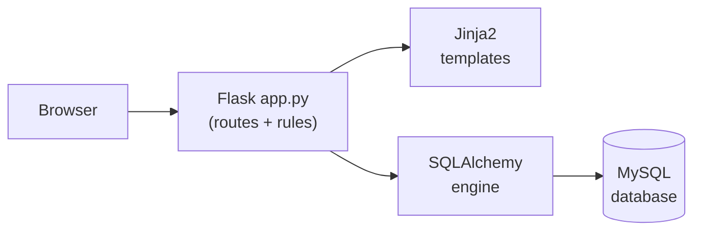
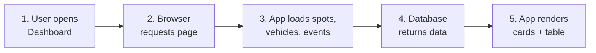
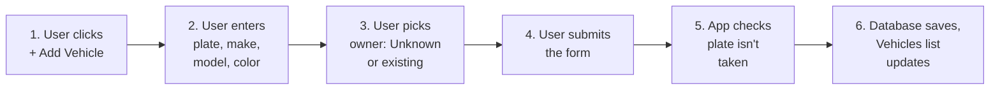
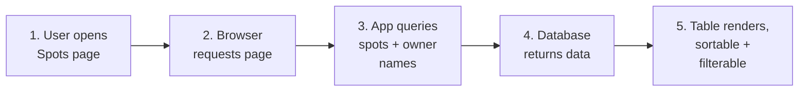
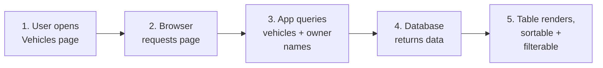
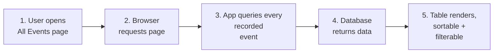
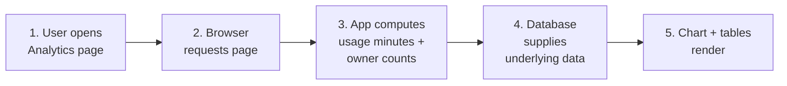
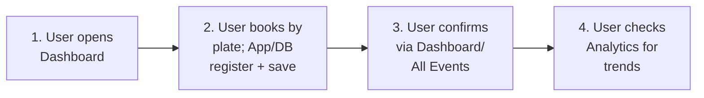

# Garage Parking App

A Flask web app for managing a parking garage: spots, vehicles, owners, and
parking events, backed by a remote MySQL database.

This README is written for someone opening this project for the first
time. It covers setup, the overall architecture, a page-by-page tour with
plain-language process diagrams for every route, the business rules the
app enforces, and how to run the automated test suite.

---

## 1. Setup

```bash
pip install -r requirements.txt
```

This installs Flask, SQLAlchemy, and PyMySQL (the MySQL driver).

## 2. Configure your database connection

Open `app.py` and edit the **CONFIGURATION** block near the top:

```python
DB_HOST = os.environ.get("DB_HOST", "your-remote-host.com")
DB_PORT = os.environ.get("DB_PORT", "3306")
DB_USER = os.environ.get("DB_USER", "your_username")
DB_PASSWORD = os.environ.get("DB_PASSWORD", "your_password")
DB_NAME = os.environ.get("DB_NAME", "garage")
```

Replace the placeholder strings with your actual remote host, user,
password, and database name — or leave the code as-is and set the matching
environment variables before launching instead (they take priority, so you
never have to commit credentials to the file):

```bash
export DB_HOST="db.example.com"
export DB_PORT="3306"
export DB_USER="db_user"
export DB_PASSWORD="db_password"
export DB_NAME="garage"
python app.py
```

**If your instance requires SSL** (common for hosted MySQL), find this line
near the bottom of the CONFIGURATION block:

```python
engine = create_engine(DATABASE_URL, pool_pre_ping=True)
```

and add `connect_args`:

```python
engine = create_engine(DATABASE_URL, pool_pre_ping=True, connect_args={"ssl": {"ssl": {}}})
```

The app connects once at startup and exits with a clear error message if
the connection fails, so a bad host/credential shows up immediately instead
of failing silently later.

## 3. Run

```bash
python app.py
```

Then open **http://localhost:5000** in your browser.

---

## Architecture



Everything lives in a single `app.py`: the Flask routes, the data-access
functions (built on SQLAlchemy Core, not an ORM), and the business-rule
checks. Templates handle presentation; `static/table-utils.js` provides
shared sort/filter behavior for every data table in the app.

### Expected schema

```
GARAGE_SPOT(spotID, spot_floor, spot_number, spot_type, ownerID)
OWNER(ownerID, owner_first_name, owner_last_name, owner_email)
VEHICLE(vehicleID, vehicle_LPN, vehicle_make, vehicle_model, vehicle_color, ownerID)
PARKING_EVENT(eventID, vehicleID, spotID, time_from, time_to)
```

`ownerID` 999 is reserved as the "Unknown owner" sentinel for vehicles with
no known owner (rather than `NULL`).

Neither `VEHICLE` nor `PARKING_EVENT` uses `AUTO_INCREMENT` — the app
computes the next ID itself as `MAX(id) + 1` before every insert.

---

## 4. Page-by-page tour

Each diagram below labels **who or what performs each step** — User, Browser,
App (`app.py`), or Database — so it's clear which actor is responsible at
every stage, not just what happens.

### Dashboard (`GET /`)

1. **User** opens the Dashboard in the browser
2. **Browser** requests the page
3. **App** loads every spot, vehicle, owner, and recorded event from the database
4. **Database** returns the data
5. **App** renders the page: summary cards, action buttons, and the full events table



The Dashboard is also where the two forms live, as modals, and it displays
the full, sortable/filterable table of recorded parking events.

### New Parking Event (button on Dashboard → `POST /create`)

Booking is **plate-based**: the user types a license plate rather than
picking from a list. If the plate isn't registered yet, the form reveals
inline registration fields so the vehicle can be created and booked in the
same step.

1. **User** clicks **+ New Parking Event**
2. **User** types a license plate; **Browser** asks the App to look it up as they type
3. **App** checks the database for that plate
4. If found: **App** shows the vehicle's details. If not found: **App** tells the Browser to reveal the "register this vehicle" fields
5. **User** (if plate was new) fills in make/model/color and picks an owner — Unknown, or an existing private-spot owner
6. **User** picks a date, start time, and duration
7. **Browser** asks the App which spots are currently allowed for this vehicle/owner and time window
8. **App** checks every spot: private spots must match the vehicle's (or chosen) owner, and the spot must be free during that window
9. **Browser** colors the map — green for allowed, red for not allowed
10. **User** clicks a green spot and submits the form
11. **App** re-checks the plate, ownership, and overlap rules on the server — registering the vehicle first if it's still new — before saving
12. **Database** stores the new vehicle (if any) and the new event
13. **App** confirms success and the Dashboard's table and counts update

```mermaid
flowchart LR
    A["1. User clicks<br/>+ New Event"] --> B["2. User types<br/>plate"]
    B --> C["3. App looks up<br/>plate"]
    C --> D["4. Found or<br/>show register<br/>fields"]
    D --> E["5-6. User fills<br/>owner/date/time<br/>if needed"]
    E --> F["7. Browser asks<br/>which spots<br/>allowed"]
    F --> G["8. App checks<br/>ownership + time<br/>conflicts"]
    G --> H["9. Map shows<br/>green/red<br/>spots"]
    H --> I["10. User picks<br/>spot, submits"]
    I --> J["11. App re-checks<br/>+ registers if<br/>new"]
    J --> K["12. Database<br/>saves vehicle<br/>+ event"]
    K --> L["13. Dashboard<br/>updates"]
```



Clicking any spot on the map (allowed or not) also fetches and displays
that spot's recorded bookings — times and durations — so the user can see
*why* a spot is unavailable, not just that it is.

### Add Vehicle (button on Dashboard or Vehicles page → `POST /vehicles/add`)

This is the standalone version of vehicle registration, for adding a
vehicle without booking it at the same time.

1. **User** clicks **+ Add Vehicle**
2. **User** enters plate, make, model, and color
3. **User** picks an owner: Unknown, or an existing owner who holds a private spot
4. **User** submits the form
5. **App** checks the plate isn't already registered
6. **Database** stores the new vehicle; **App** confirms and the Vehicles list updates



### Spots (`GET /spots`)

1. **User** opens the Spots page
2. **Browser** requests the page
3. **App** queries every garage spot, joined with owner names for private spots
4. **Database** returns the data
5. **App** renders a sortable, filterable table




### Vehicles (`GET /vehicles`)

1. **User** opens the Vehicles page
2. **Browser** requests the page
3. **App** queries every vehicle, joined with owner names
4. **Database** returns the data
5. **App** renders a sortable, filterable table, plus its own Add Vehicle button



### All Events (`GET /events`)

1. **User** opens the All Events page
2. **Browser** requests the page
3. **App** queries every recorded parking event
4. **Database** returns the data
5. **App** renders a sortable, filterable table



### Analytics (`GET /analytics`)

1. **User** opens the Analytics page
2. **Browser** requests the page
3. **App** computes total minutes booked per spot, and private-spot counts per owner
4. **Database** supplies the underlying spot, vehicle, and event data for those calculations
5. **App** renders a bar chart of the top 5 busiest spots, a full usage table, and an owner-counts table



### Typical end-to-end workflow

How the pages connect in normal use:

1. **User** opens the Dashboard
2. **User** books a parking event by plate — registering the vehicle inline if it's new (**App** and **Database** handle the lookup/registration/booking)
3. **User** checks the Dashboard or All Events to confirm the booking (**App** re-queries the **Database**)
4. **User** checks Analytics to see usage trends over time (**App** computes them from **Database** data)



---

## 5. Business rules the app enforces

- **Public spots** — any vehicle can be booked into them.
- **Private spots** — only a vehicle owned by that spot's owner can be
  booked into it. Checked both live in the map (client-side, informational)
  and again on the server when the form is submitted (authoritative — can't
  be bypassed by editing the form in the browser).
- **No spot double-booking** — a new event is rejected if it overlaps an
  existing event for the same spot.
- **No vehicle double-booking** — a new event is rejected if the vehicle
  already has an overlapping event in a different spot.
- **Duration** — constrained to 1–10 hours; the end time is computed
  automatically from the start time and duration.
- **Unknown vehicle owner** — stored as `ownerID = 999`, a real row in
  `OWNER`, rather than `NULL`.
- **No AUTO_INCREMENT** — both `VEHICLE` and `PARKING_EVENT` primary keys
  are assigned explicitly as `MAX(id) + 1` before insert.

---

## 6. Testing

The test suite runs entirely offline — it never touches your real MySQL
database. `tests/conftest.py` redirects `app.py`'s database connection to a
disposable local SQLite file before any test runs, seeded with known data
and reset before every test.

Install dev dependencies:

```bash
pip install -r requirements-dev.txt
```

Run the full suite in a pinned, feature-grouped order with live PASS/FAIL
output:

```bash
python run_tests.py
```

Or run it with plain pytest (any order, standard output):

```bash
pytest tests/ -v
```

`run_tests.py` refuses to run — printing exactly what's out of sync — if a
test is added, removed, or renamed without updating its pinned order list,
so the list can't silently drift out of step with the actual tests.

Coverage includes:
- Business-rule unit tests: the full overlap boundary matrix (touching,
  partial, nested, identical ranges), ownership checks, explicit-ID
  assignment, owner queries, analytics calculations
- Route-level tests: every page, both form endpoints (valid and every
  rejection path), and all API endpoints
- Hostile input: SQL special characters in a license plate, HTML/`<script>`
  content (confirmed escaped, not executed), oversized input, malformed
  IDs, and wrong HTTP methods

---

## Project structure

```
parking_app_flask/
├── app.py                     # Routes, data access, business rules
├── run_tests.py                # Pinned test runner with PASS/FAIL output
├── requirements.txt
├── requirements-dev.txt
├── README.md
├── templates/
│   ├── base.html               # Nav bar + flash messages
│   ├── index.html               # Dashboard (+ New Event / Add Vehicle modals)
│   ├── spots.html
│   ├── vehicles.html
│   ├── events.html
│   └── analytics.html
├── static/
│   ├── style.css
│   └── table-utils.js          # Shared sortable/filterable table logic
└── tests/
    ├── conftest.py              # SQLite test fixture
    ├── test_business_rules.py
    └── test_routes.py
```
